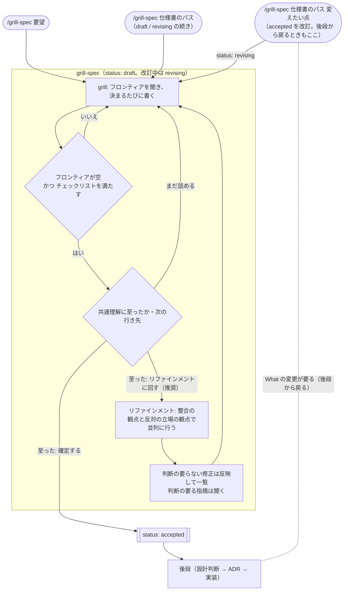

# grill-spec: 作りたい機能を問い詰めて仕様書に残すスキル

この仕様書の用語は [用語集](../../../../../CONTEXT.md) に従う。

## 課題

- **P1**: 開発者がエージェントと開発するとき、「そもそも何を作りたいか」（誰の何を解くか、どこまでやるか）を
  問い詰めるフェーズが無い。`grill-with-docs` は用語集（`CONTEXT.md`）と ADR しか残さず、ストーリー・
  受け入れ基準・スコープ外を残す場所が無い。
- **P2**: 開発者が後段（仕様を実現するための設計判断を聞いて ADR に落とし、実装に進む）に進むとき、入力に
  なる文書が無い。What / Why が会話の中にしか残らない。
- **P3**: 開発者と問い詰めたエージェントは同じ会話の文脈を共有しているので、仕様書の中の曖昧さ・矛盾・対応
  漏れに自分では気づきにくい。気づかないまま確定すると、後段がそれを解釈で埋めることになる。

## ユーザーストーリー

- **S1**: 開発者として、任意のリポジトリで作りたい機能を問い詰めてもらい、ストーリー・ジャーニー・
  受け入れ基準・スコープ外を仕様書に残したい（→ P1, P2）
- **S2**: 開発者として、grill 中に話した実装方法を失わずに、決まっているものは出典付きの制約、迷っている
  ものは設計上の論点として後段へ渡したい（→ P2）
- **S3**: 開発者として、既存の仕様書を読み込ませて差分だけ問い詰め、その場で書き換えたい。後段で What の
  変更が要ると分かったときも、ここに戻って直したい（→ P1, P2）
- **S4**: 開発者として、仕様の grill で決まった用語を用語集に残し、後段の `grill-with-docs` でもそのまま
  使いたい（→ P2）
- **S5**: 開発者として、仕様書の置き場が複数あるリポジトリ（全体の仕様とパッケージ固有の仕様を分けている
  など）で、リポジトリの規約に従って正しい置き場に仕様書を書いてほしい（→ P2）
- **S6**: 開発者として、grill の途中で別の仕様書にすべき話題が出たとき、今の仕様に集中したまま、後でその
  仕様書を作ることを忘れないようにしたい（→ P1）
- **S7**: 開発者として、共通理解に至った仕様書を、会話の文脈を持たない別のレビュー（整合の観点と反対の立場の
  観点）にかけ、指摘を反映してから確定したい（→ P3）

## ユーザージャーニー

### 全体の流れ

共通理解に至っても、仕様書はまだ確定しない。既定ではリファインメントを挟み、指摘を反映して grill に戻る。
開発者が「確定する」を選んだときだけ accepted になる。改訂（J2）も同じ輪を revising で回る。

### J1: 新しい機能の仕様書を作る（S1, S2, S4, S5, S6, S7）

1. 開発者が任意のリポジトリで `/grill-spec <要望>` を実行する。draft の仕様書のパスを渡した場合は、その
   続きから始まる（手順 2 のリポジトリの事実は読み直すが、置き場は決め直さない）。続きのフロンティアは、
   仕様書の空の節・終了のチェックリストで満たさない項目・前回のレビューで未回答のまま残った判断の要る指摘から作る。
   変えたい点を添えた場合は、それについての問いも加える
2. スキルがリポジトリの事実（用語集、既存の仕様書、ADR、指示ファイル、関連コード）を自分で調べ、置き場を
   決める。優先順は「指示ファイルの規約 → 既存の仕様書の流儀 → 既定の `docs/internal/specs/`」。規約が
   あれば話題の置き場の単位を推定して従い、推定できなければ聞く。規約が無く既存の流儀があれば、従うかを
   最初のラウンドで聞く。同じ話題らしい draft / revising の仕様書が既にあれば、そのパスを示して、続きにするか
   新規にするかを最初のラウンドで聞く
3. スキルが今聞ける質問（フロンティア）を `AskUserQuestion` でまとめて出し、開発者が答える。開発者の発言が
   用語集・ADR・コードと食い違えば、その食い違いも質問にする
4. 用語が決まれば用語集に、節の内容が決まれば仕様書に、その場で書く。途中で機能名が変わったら、連番はそのままで
   ファイル名を変え、仕様書を参照している台帳・ADR・他の仕様書の参照も張り替える
5. 開発者が実装方法を話したら、スキルが出典付きの制約か設計上の論点かを振り分けて仕様書に書く
6. 別の仕様書にすべき話題が出たら、スキルは深追いせず、未作成の仕様書として記録して今の仕様に戻る
7. フロンティアが空になり、終了のチェックリストを満たしたら、スキルが共通理解に至ったかと次の行き先を 1 問で
   聞く: 「至った: リファインメントに回す」「至った: 確定する」「まだ詰める」。推奨は、直前のレビューで
   1 件ずつ聞く指摘（手順 9）が 0 件か、台帳に却下として残る指摘の再発だけなら確定、それ以外（この版でまだ
   レビューを通していないときを含む）はレビュー。
   「まだ詰める」なら、詰めたい点を自由記述で聞き、それをフロンティアにする。この時点では status を変えない
8. 「リファインメントに回す」なら、スキルが会話の文脈を持たない 2 つのレビューを並列に行う。1 つは仕様書の
   中の整合（曖昧さ・矛盾・ストーリー / ジャーニー / 受け入れ基準の対応漏れ・検証できない受け入れ基準・
   用語集や ADR との食い違い）、もう 1 つは反対の立場からの批評（懸念・批判・代案。指摘ごとに致命的・重要・
   軽微の重要度を付ける）
9. スキルが指摘を、判断の要らない修正と判断の要る指摘に分ける。判断の要らない修正は、何を作るか・受け入れ
   基準の合否・スコープを変えないものに限り、その場で仕様書に反映して一覧で示す。判断の要る指摘のうち、
   反対の立場の致命的・重要な指摘、仕様書に書いてある決定を覆す指摘、整合の観点の指摘は 1 件ずつフロンティア
   として聞く（手順 3 に戻る）。反対の立場の軽微な指摘は一覧で示し、まとめて採否を選ばせる。未回答の指摘・
   開発者が却下した指摘・レビューの周回は、仕様書の隣の台帳に残し、中断しても失われない。各レビューの報告は
   全文を開発者が開けるファイルとして残し、指摘を聞くときも一覧で示すときも、その指摘が書かれた報告の
   場所（パスと行）を添える
10. 「確定する」なら、スキルが status を accepted にし、date を確定日にして、決定のまとめ・足した用語・未作成の仕様書を一覧にして
    終わる

### J2: 既存の仕様書を改訂する（S2, S3, S4, S7）

1. 開発者が既存の仕様書と変えたい点を指して `/grill-spec` を実行する。後段で What の変更が要ると分かった
   ときもここから入る。変えたい点を添えずに accepted の仕様書を渡した場合は、変えたい点を聞いてから始まる。
   revising の仕様書を指した場合は、その続きから始まる（続きのフロンティアは J1 手順 1 と同じ作り方に、台帳に
   残した変えたい点のうち決まっていないものを加える）
2. スキルが accepted の仕様書の status を revising にし、変えたい点を台帳に残して、それを起点にフロンティアを
   出す
3. 決まった差分・用語・実装方法の振り分けを、J1 の 4・5 と同じくその場で書く。ID を振り直したら、その仕様書の
   ID を参照している ADR・台帳・他の仕様書の参照も張り替える
4. 共通理解と次の行き先・リファインメント・指摘の振り分けは、J1 の 7〜9 と同じ。ただし status は revising のまま
5. 「確定する」なら、status を accepted に戻し、date を改訂日にして、変えた点のまとめを出す

## 受け入れ基準

### 全体（仕様書の性質）

- **AC1**: 仕様書は課題・ユーザーストーリー・ユーザージャーニー・受け入れ基準・スコープ外・制約・設計上の
  論点の節を持つ。非機能要件の節は該当するときだけ持つ。front matter に status（draft / accepted / revising）と
  date を持つ。date は最後に確定した日（まだ一度も確定していない draft では作成日）
- **AC2**: 各ストーリーが課題 ID を指し、課題を指さないストーリーが無い。ストーリーの主語は人間だけで、
  エージェントや他スキルとの取り決めは制約か設計上の論点に書かれている
- **AC3**: 制約の各行に出典がある。出典は ADR へのリンクか、「この grill で決定: 理由 / 却下案」のどちらか
- **AC4**: 仕様書と用語集は、本文も、書式が決める決まり文句と見出し（用語集の `## 用語`・`_使わない_:`、
  仕様書の AC1 の各節の見出し）も、導入先リポジトリの言語で書かれている。ID の接頭辞（P / S / J / AC /
  D）と status の値は言語によらず同じ
- **AC5**: 設計上の論点の各行に ID（D1, D2…）が振られている
- **AC6**: 仕様書の題の直後に、その仕様書が使う用語集へのリンクがある。仕様書で使うプロジェクト固有の語は、
  すべて用語集に定義がある
- **AC7**: 仕様書の隣に台帳ファイルがあり、未回答の判断の要る指摘・却下した指摘（理由付き）・改訂で変えたい
  点・リファインメントの周回が残っている。仕様書本体には AC1 の節と front matter 以外を書かない

### J1

- **AC8**（手順 1）: 任意のリポジトリに `apm install grill-spec@dotagents` で導入できる。また、ユーザー
  スコープに `apm install -g grill-spec@dotagents` で導入できる
- **AC9**（手順 1）: 導入後、AI エージェントツール（現状は Claude Code）から `/grill-spec` で起動できる
- **AC10**（手順 1）: draft の仕様書のパスを渡して起動すると、新しいファイルを作らず、status を変えずに
  続きから始まる。置き場は聞き直さず、仕様書に書かれた決定は質問し直さない。フロンティアは、仕様書の空の節・
  終了のチェックリストで満たさない項目・台帳に未回答のまま残った判断の要る指摘から作られる。変えたい点を
  添えて起動した場合は、それについての問いも加わる
- **AC11**（手順 2）: ファイルやコードを読めば答えが決まる事項（有無・内容・現在の挙動）は、質問に
  含まれない。採否の判断は質問してよい
- **AC12**（手順 2）: 指示ファイルに置き場の規約があれば、規約がその話題の単位に割り当てた置き場に書き、
  単位を推定できなければ聞く。規約が無く既存の流儀があれば、従うかを最初のラウンドで聞き、従う場合に合わせるのは置き場とファイル名の形式（連番を含む）だけで、節の構成は AC1 の
  とおり。どちらも無ければ `docs/internal/specs/` に書く
- **AC13**（手順 2）: 既存の流儀に従わない場合、仕様書のファイル名は `NNNN-<kebab-case の機能名>.md` で、連番は置き場ごとに 0001 から
  振る
- **AC14**（手順 3）: 質問は `AskUserQuestion` で出す。1 回に最大 4 問で、フロンティアが 5 問以上なら同じ
  ラウンドの中で 4 問ずつ続けて出し、他の問いの前提になるものを先に出す。推奨する選択肢は先頭に置き、
  ラベルに推奨の印を付ける
- **AC15**（手順 3）: 開発者の発言が、読み込んだ用語集・ADR・コードと食い違ったとき、その食い違いを示した
  質問が次のフロンティアに入る
- **AC16**（手順 2）: 同じ話題らしい draft / revising の仕様書があるときにパスを渡さずに起動すると、最初の
  ラウンドでそのパスが示され、続きにするか新規にするかを聞かれる
- **AC17**（手順 4）: 仕様書は置き場と名前が決まった時点で `status: draft` で作られ、以降は決まるたびに
  書き足される。セッションを途中で打ち切っても、それまでに決まった内容がファイルに残っている
- **AC18**（手順 4）: grill の途中で機能名が変わると、連番を保ったままファイル名が新しい機能名になり、
  その仕様書を参照している台帳・ADR・他の仕様書の参照が新しいパスを指している
- **AC19**（手順 4）: 用語集は `grill-with-docs` の `CONTEXT-FORMAT.md` の書式に従う。`CONTEXT-MAP.md` が
  あるリポジトリでは、1 つのコンテキストでしか使わない用語はそのコンテキストの `CONTEXT.md` に書き、
  複数のコンテキストで使う用語は、マップの「コンテキスト」の説明に「共通」と書かれたコンテキストに書く。
  共通のコンテキストは話題にかかわらず常に読む。マップに共通のコンテキストが無ければ、複数のコンテキストで
  使う用語の置き場を聞く
- **AC20**（手順 5）: 開発者の発言のうち、実装の技術選定・内部構造・実装手順に触れたものは、制約か設計上の
  論点のどちらかに 1 行以上入っている。確定するときのまとめに、制約と論点に振り分けた発言の一覧が出る
- **AC21**（手順 6）: 別の仕様書にすべき話題は、元の仕様書のスコープ外に「未作成の仕様書: <題> — 決まった
  点」として書かれる。リポジトリが issue トラッカーを使っている（指示ファイルがトラッカーを名指ししている、
  `.beads/` がある、GitHub か GitLab の issues が有効になっている）なら、作ってよいかを確かめてから issue を
  作る。どのトラッカーに当たるか曖昧なら聞く
- **AC22**（手順 7）: 共通理解と次の行き先を聞く前に、次のチェックリストをすべて満たしている。満たさない
  項目は次のフロンティアになる
  - すべての課題を指すストーリーがある
  - すべてのジャーニーの手順に、対応する受け入れ基準がある
  - 受け入れ基準の各項目の合否を 1 通りに判定できる（「適切に」「など」「十分に」のような語を含まない）
  - 制約のすべての行に出典がある
  - 仕様書で使うプロジェクト固有の語が、すべて用語集に定義されている
- **AC23**（手順 7）: 共通理解と次の行き先を 1 問で聞き、選択肢は「至った: リファインメントに回す」
  「至った: 確定する」「まだ詰める」の 3 つ。先頭の推奨は、直前のレビューで 1 件ずつ聞く指摘（AC25）が
  0 件か、台帳に却下として残る指摘と同じ変更を求める指摘だけなら「確定する」、それ以外（この版、つまり
  draft の作成か revising への変更の後でまだレビューを通していないときを含む）は「リファインメントに回す」。「まだ詰める」を選ぶと詰めたい点を自由記述で聞かれ、その答えが次の
  フロンティアになる。答えるまで status は変わらない
- **AC24**（手順 8）: リファインメントは、この会話の履歴を持たない文脈で、整合の観点と反対の立場の観点の 2 つが
  並列に行われる。渡すのは仕様書・用語集・仕様書が参照する ADR のパスと、「仕様書に書いてあることは確定済み
  とみなし、覆すなら反対意見として明示する」という指示だけで、仕様書の外で作った決定の要約は渡さない。
  整合の観点の指摘には仕様書の行番号が、反対の立場の指摘には致命的・重要・軽微の重要度が付く
- **AC25**（手順 9）: 判断の要らない修正はその場で仕様書に反映され、一覧で示される。判断の要らない修正に入る
  のは、何を作るか・受け入れ基準の合否・スコープを変えない修正（誤字、番号や参照の食い違い、書式の違反、
  用語集の語への置き換え）だけで、反対の立場の指摘・仕様書に書いてある決定を覆す指摘・どちらか迷うものは
  判断の要る側に入る。判断の要る指摘のうち、反対の立場の致命的・重要な指摘・決定を覆す指摘・整合の観点の
  指摘は AC14 の形式で 1 件ずつ聞かれ、反対の立場の軽微な指摘は一覧で示されてまとめて採否を聞かれる。答えは
  仕様書に反映され、却下された指摘は理由付きで台帳に残る。レビューの前後で status は変わらない
- **AC26**（手順 9）: 各周・各観点のレビュー報告の全文が、開発者が開けるファイルとして残っている。判断の要る
  指摘を聞く質問と、反映した修正・軽微な指摘の一覧には、その指摘が書かれた報告のパスと行が付いている
- **AC27**（手順 9）: 判断の要る指摘に答え終わる前にセッションを打ち切っても、未回答の指摘が台帳に残り、
  再開したときにフロンティアに入る
- **AC28**（手順 10）: status が accepted になるのは「確定する」を選んだときだけで、スキルは確定の前に後段
  （設計判断・ADR・実装）の作業に進まない。確定すると date が確定日になり、決定のまとめ・足した用語・未作成の
  仕様書の一覧が出る

### J2

- **AC29**（手順 1・2）: 改訂では新しいファイルを作らない。変えたい点を添えずに accepted の仕様書を渡すと、
  変えたい点を聞かれてから revising になる。accepted の仕様書は status を revising にしてから
  書き換え、revising の仕様書は status を変えずに続きから始める
- **AC30**（手順 2・3）: 改訂中も AC11・AC14・AC15・AC19・AC20・AC21 と、AC17 の後半（決まるたびに書き足され、途中で
  打ち切っても残る）が成り立つ。変えたい点は台帳に残る
- **AC31**（手順 3）: ID を振り直したとき、その仕様書の ID を参照している ADR・台帳・他の仕様書の参照が、
  振り直した後の ID を指している
- **AC32**（手順 4）: 改訂中も AC22〜AC27 が成り立ち、status は revising のまま
- **AC33**（手順 5）: 「確定する」を選んだときだけ status が accepted に戻り、date が改訂日になり、変えた点の
  まとめが出る。スキルは確定の前に後段の作業に進まない

## スコープ外

- 仕様書を入力に設計判断を問い詰めて ADR に落とし、実装へ進む後段のスキル
- **未作成の仕様書: dotagents のワークフローグラフに ① specify を加え、仕様書を ② design の入力にする**
  （beads: `dotagents-3kb`） — 決まった点: 前工程を SCC ① specify にし、SCC を ① specify / ② design /
  ③ build / ④ review に振り直す。① deliberate → design、中の案出しノード → propose の改名は実施済み。
  仕様書を design に渡す 5 点（intake での構造化、論点を open の初期値に、受け入れ基準を評価軸に、
  spec-change で仕様へ戻る、台帳と ADR に仕様書と ID を持たせる）
- 後段が accepted 以外の仕様書を入力にすること。後段は accepted の仕様書だけを入力にし、改訂中（revising）の
  間は進めない。その確認は後段の側で行う
- 別のブランチで同時に書いた仕様書の連番の衝突。マージの段階で衝突したら振り直す
- 設計を詰めて初めて分かる What の欠陥を、リファインメントで見つけること。それは後段から J2 に戻って直す
- 自分以外の環境での動作保証（他人が使うことは妨げないが、受け入れ基準は自分の環境で満たせばよい）
- **未作成の仕様書: dotagents の開発者向け文書をスコープ（全体 / パッケージ）ごとに分けて置く**（beads: `dotagents-vhd`） — 決まった点:
  - 仕様書・ADR・用語集を、dotagents 全体に関わるものと特定のパッケージに関わるものに分ける
  - 仕様書と ADR は、全体を `docs/internal/{specs,adr}/`、パッケージ固有を
    `packages/<name>/docs/internal/{specs,adr}/` に置き、連番は置き場ごとに振る。仕様書の分は `CLAUDE.md` に
    書いた（2026-09-25）。ADR はまだ
  - 用語集は、共通の用語をルートの `CONTEXT.md`、パッケージ固有の用語を `packages/<name>/CONTEXT.md` に置く。
    用語集が 2 つ以上になったら `CONTEXT-MAP.md` を作り、ルートを共通コンテキストとして載せる。パッケージは
    1 つずつ列挙せず、「各パッケージの用語は各パッケージの `CONTEXT.md` にある」と 1 行で書く
  - パッケージの `docs/internal/` は `apm install` でキャッシュ（`~/.apm/apm_modules/`）には入るが、
    エージェントの文脈には入らない
  - 論点: 配置規約を ADR にする（3 条件を満たす）、既存の `docs/adr/`（21 本）・`docs/design/` の移行と
    パッケージ固有 ADR の振り分け、リンク（この仕様書の ADR リンクを含む）・`CLAUDE.md`・`tests/` の張り替え、
    `tests/test_apm.py` が `apm.yml` の無い `packages/<name>/` をどう扱うか

## 制約

- 対象は Claude Code のみ（[ADR 0021](../../../../../docs/adr/0021-target-claude-code-only.md)）
- 標準の APM マーケットプレイス構成に従い、`packages/grill-spec/.apm/skills/grill-spec/SKILL.md` に置く
  （[ADR 0002](../../../../../docs/adr/0002-apm-standard-marketplace-layout.md)）
- `grill-with-docs` とは別パッケージにし、`grill-with-docs` 自体は変更しない（この grill で決定: スコープを
  仕様書の出力までに切るため / 却下案: `grill-with-docs` に仕様フェーズを足す）
- 用語集の書式は `grill-with-docs` の `CONTEXT-FORMAT.md` から外れない（この grill で決定: 後段が同じ用語集を
  読めるようにするため / 却下案: 「直下は常に共有」の規則を書式に足す）

## 設計上の論点

- **D1**: ADR 候補: `grill-with-docs` と別パッケージにする決定（戻しにくく、代替案があった）
- **D2**: 仕様書の書式（テンプレート）を SKILL.md 本文に書くか、`CONTEXT-FORMAT.md` のように別ファイルに分けるか
- **D3**: `CONTEXT-FORMAT.md` を `grill-with-docs` と共有する方法（コピーか参照か）。参照にすると、APM ではパッケージ
  間の依存の宣言が要る見込み（未検証）
- **D4**: 導入先リポジトリの言語の判定方法（README や既存文書の多数派など）と、判定できないときの動き
- **D5**: リファインメントの実行方法。dotagents の役割（`reviewer` / `critic`）に頼るか、スキルの中に
  レビューの観点と指示を持って汎用のサブエージェントに渡すか。役割の無い環境での動き
- **D6**: 台帳の形と置き場（仕様書の隣のどこに、どの書式で置くか。コミットするか）と、レビュー報告の置き場
- **D7**: リファインメントの手順（2 つの観点の指示、渡すもの、振り分けの条件）を SKILL.md 本文に書くか、
  別ファイルに分けてレビューの直前に読み込むか（長い grill の終盤で指示が落ちないようにするため）
- **D8**: 受け入れ基準の確かめ方。スキル（プロンプト）の振る舞いを、固定の要望で動かして確かめるか、
  セッションの記録を読んで判定するか。AC11・AC20 のように判断を含む基準の判定方法
- **D9**: dotagents のワークフローグラフに ① specify ができたとき（未作成の仕様書 `dotagents-3kb`）、
  このスキルの中のレビューの輪と、グラフの台帳・離脱規則をどう寄せるか
